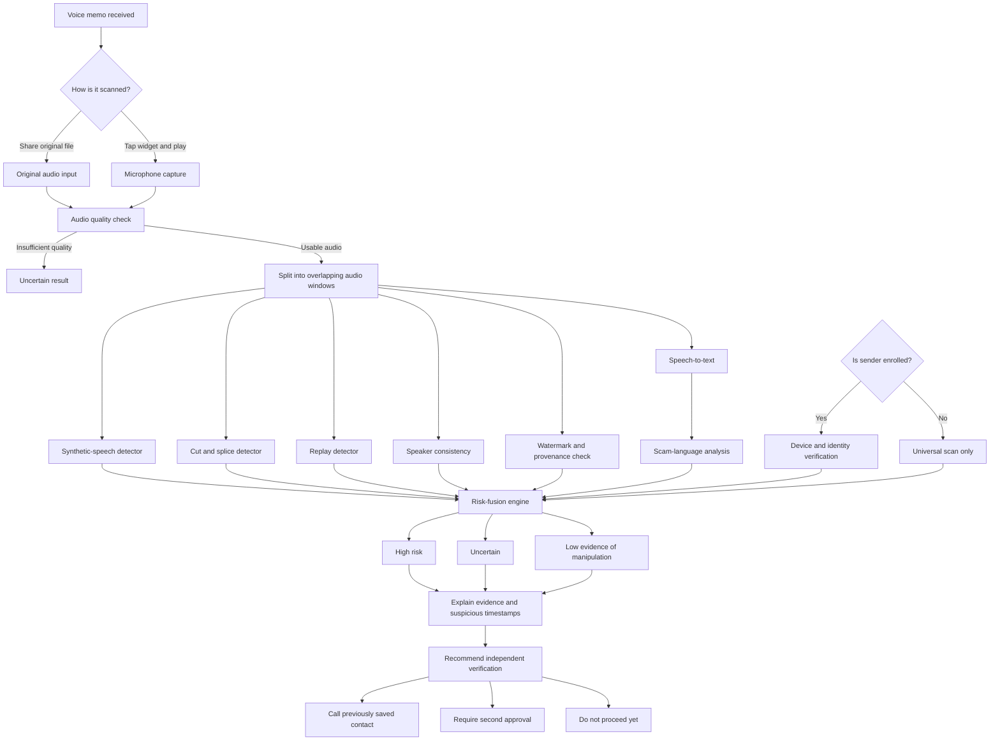
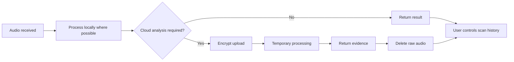

# DEUZ System Architecture

## Purpose

This document maps the proposed DEUZ voice-memo analysis pipeline. It is a conceptual architecture and will evolve as detection experiments provide evidence about accuracy, latency, privacy, and cost.

## Voice-Memo Analysis Map

## Privacy and Retention Map

## Architectural Principles

### Independent Evidence Layers

Each detector produces separate evidence. A successful voice match or device verification must not erase a warning from the splice, replay, synthetic-speech, or scam-language detectors.

### Streaming Results

DEUZ should process short overlapping audio windows and return preliminary warnings while the memo is still playing. Preliminary results must be labelled clearly and may change as more audio is analysed.

### Universal Detection First

The sender does not need a DEUZ account. Every memo can receive the universal audio and scam-risk checks. Enrolled sender and device information adds evidence but is not required.

### Uncertainty Is a Valid Result

If the recording is too short, noisy, damaged, or outside model coverage, the system should return **Uncertain** instead of forcing a safe or dangerous verdict.

### Privacy by Default

Processing should occur on-device where practical. Raw audio sent to cloud services should be encrypted, retained only as long as necessary, and deleted automatically unless the user explicitly chooses otherwise.

## Proposed Components

1. Widget and share-sheet entry points
2. Audio decoder and quality analyser
3. Voice-activity detector
4. Streaming window processor
5. Synthetic-speech detector
6. Splice and change-point detector
7. Replay detector
8. Optional speaker and device verification
9. Watermark and provenance checker
10. Speech-to-text service
11. Scam-language analyser
12. Calibrated risk-fusion engine
13. Evidence timeline and safe-action interface
14. Encrypted storage and deletion service

## Current Status

This architecture is a proposal. No production detection backend has been implemented or validated yet.
